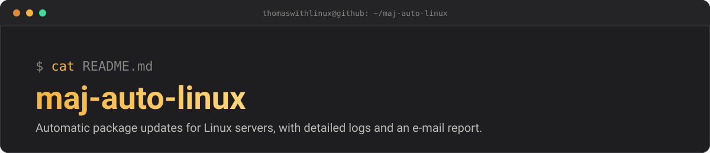

<p align="center">
  
</p>

# maj-auto-linux — *patch it, log it, mail it*


Automatic **package update** script for Linux servers. It detects the
distribution, updates the packages, keeps detailed logs and sends a summary
report by e-mail. One Bash file, no dependency beyond a mail agent.

## Table of contents

- [Overview](#overview)
- [Features](#features)
- [Supported distributions](#supported-distributions)
- [Requirements](#requirements)
- [Installation](#installation)
- [Configuration](#configuration)
- [Usage](#usage)
- [Scheduling with cron](#scheduling-with-cron)
- [Generated logs](#generated-logs)
- [The summary e-mail](#the-summary-e-mail)
- [Exit codes](#exit-codes)
- [Security and good practices](#security-and-good-practices)
- [Project structure](#project-structure)
- [License](#license)
- [Author](#author)

## Overview

Keeping a server up to date is essential (security fixes, bug fixes). This
script automates the whole routine, whatever Linux distribution is used.

> **Analogy:** picture a building caretaker who, every night, checks whether
> repairs are needed, carries them out, writes everything in a logbook, then
> drops a summary in your mailbox. This script is that caretaker for your
> server.

## Features

1. **Automatic detection** of the Linux family (via `/etc/os-release`).
2. **Refresh** of the package indexes (the equivalent of `apt update`).
3. **List** of the packages to upgrade before installing them.
4. **Non-interactive upgrade** of the packages (`upgrade`).
5. **Complete logs** in a timestamped folder created by the script.
6. **Summary** `.txt` file (status, number of packages, reboot required,
   upgrade excerpt).
7. **E-mail delivery** of the summary as an attachment.
8. **Anti-duplicate lock** (`flock`): two instances can never run at the same
   time.
9. **Automatic cleanup** of logs older than 30 days.
10. **Automatic `sudo` re-launch** when the script is not started as root.

## Supported distributions

| Family  | Distributions (examples)                               | Package manager |
|---------|--------------------------------------------------------|-----------------|
| Debian  | Debian, Ubuntu, Linux Mint, Raspbian, Kali, Pop!_OS    | `apt`           |
| Red Hat | RHEL, Fedora, CentOS, Rocky, AlmaLinux, Oracle, Amazon | `dnf` / `yum`   |
| Arch    | Arch, Manjaro, EndeavourOS                             | `pacman`        |
| SUSE    | openSUSE (Leap/Tumbleweed), SLES                       | `zypper`        |
| Alpine  | Alpine Linux                                           | `apk`           |

## Requirements

- A Linux system with **Bash** and **root** privileges (or `sudo`).
- For e-mail delivery: a configured mail agent providing one of the following:
  - `sendmail` (postfix, exim, msmtp, ssmtp…) — preferred, with a MIME
    attachment;
  - `mutt`;
  - `mail` / `mailx`.
- The script tries these methods in that order. If none is available, the
  update still runs; only the e-mail is not sent.

> **Analogy:** the script knows how to *write* the letter, but it needs a
> *postman* (the MTA) to deliver it. Without a configured postman, the letter
> stays on the desk.

## Installation

```bash
git clone https://github.com/thomaswithlinux/maj-auto-linux.git
cd maj-auto-linux
chmod +x maj_auto.sh
```

## Configuration

The settings are at the top of `maj_auto.sh`, in the **"1. CONFIGURATION"**
section:

| Variable          | Purpose                                          | Default value                  |
|-------------------|--------------------------------------------------|--------------------------------|
| `MAIL_DEST`       | Address that receives the summary                | `thomasletard3@gmail.com`      |
| `MAIL_FROM`       | Displayed sender                                 | `maj-auto@<machine-name>`      |
| `LOG_BASE`        | Root folder for the logs                         | `/var/log/maj_auto`            |
| `RETENTION_JOURS` | Age (in days) after which logs are deleted       | `30`                           |

> **Important:** replace `MAIL_DEST` with **your own address** if you are not
> the original owner of the script.

## Usage

```bash
sudo ./maj_auto.sh
```

The script prints its progress on screen in 4 steps:

1. Refresh of the package indexes
2. List of the packages to upgrade
3. Package upgrade (skipped when there is nothing to do)
4. Summary and e-mail delivery

## Scheduling with cron

To run it every night at 03:00, edit root's crontab:

```bash
sudo crontab -e
```

then add:

```cron
0 3 * * * /path/to/maj_auto.sh >/dev/null 2>&1
```

> **Analogy:** `cron` is Linux's programmable alarm clock: it starts the script
> at the chosen time, without you having to think about it.

## Generated logs

Each run creates its own timestamped folder:

```
/var/log/maj_auto/
└── 20261005_143012/
    ├── global.log              # complete journal
    ├── 01_refresh_index.log    # output of the index refresh
    ├── 02_paquets_a_maj.log    # list of the packages concerned
    ├── 03_upgrade.log          # output of the upgrade
    └── RECAPITULATIF.txt       # summary sent by e-mail
```

The folder is protected (`chmod 750`): only root and its group can read it.

## The summary e-mail

- **Subject:** `SAUVEGARDE DU JOUR : DD/MM/YYYY - HH:mm:ss`
- **Body:** machine, distribution, number of packages, reboot required.
- **Attachment:** `recapitulatif_maj_<machine>_<date>.txt`.

## Exit codes

| Code | Meaning                                                              |
|------|----------------------------------------------------------------------|
| `0`  | Refresh and upgrade succeeded                                        |
| `1`  | A step failed, or fatal error (useful for cron / monitoring)         |

## Security and good practices

- Existing configuration files are **kept** during Debian/Ubuntu upgrades
  (`--force-confold`).
- The upgrade never performs a major version change of the distribution.
- The server is **never** rebooted automatically: the e-mail only tells you
  whether a reboot is required (checked on Debian/Ubuntu and Red Hat).
- Test the script on a non-critical machine first, before automating it in
  production.

## Project structure

```
maj-auto-linux/
├── docs/
│   └── banner.svg      # README banner
├── maj_auto.sh         # the update script
├── LICENSE             # MIT license
└── README.md           # this file
```

## License

Released under the **MIT** license — see the [LICENSE](LICENSE) file.

## Author

**Thomas Letard** — [@thomaswithlinux](https://github.com/thomaswithlinux) ·
[Portfolio](https://thomaswithlinux.github.io/)
